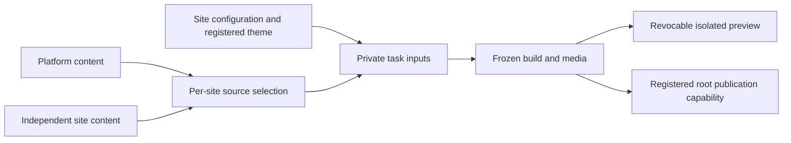

English | [简体中文](./CONTENT_WORKSPACES_ZH.md)

# Content, websites and publishing

The platform content library owns blogs, albums, places and friends independently of websites. Its storage scope is not a website record. Full sessions may read the library; platform administrators may edit it. The existing content store provides validation, atomic file replacement and digest ETags for both scopes.

Each managed website chooses platform or independent content separately for the four categories. Site members can read the resolved data. Shared data remains read-only in the site workspace and links to the platform editor; editors do not gain platform-write permission through a site or background media task. Switching sources changes only the mapping, guarded by its own revision ETag. Independent data and site configuration stay available when switching back.

The blog workspace groups articles, categories, tags and media. Existing directory and category terms can be imported together while article references remain compatible with themes. The media view imports files or folders: selecting the old `uploads` folder preserves paths below `/wp-content/uploads/`. JPEG, PNG, WebP and GIF are supported; existing paths are never overwritten, and failures are listed. Rebuild after import to freeze these images into the published snapshot; conflicting source paths fail the build. Existing files still need to be imported.

Article date-times are saved in UTC; date-only values retain their calendar date. Display time zone and date formats are browser preferences.

Source kind and workspace capabilities are separate. Redirects, proxies and protected management endpoints stay in Caddy configuration management. A registered directory-backed static website can be adopted without changing its current contents, choose a registered theme, configure that theme and its site profile, build and preview. Menus and API guards consume the same workspace model. Overview counts come from the selected content; no traffic numbers are invented when analytics is unconfigured.

Build creation freezes the source mapping. Execution copies the selected content and site configuration into the private task; theme preparation and album indexing cannot modify the library through the build. Images, legacy article assets and album media are frozen alongside the artifacts. Preview serves those frozen files and rejects service-worker registration; closing a preview revokes leases and removes the wrapper frame. Old links do not start another origin.

The root-only `fuyao-caddy-register` tool verifies complete Caddy configurations and can register supported inline blocks or direct imports. It is not granted to the application through sudo. Publication requires an additional operator policy binding the site ID, allowed theme IDs and fixed path slots. The helper seals the selected release and media under root ownership, preserving unrelated routes, shared snippets and proxy rules. The activation bridge coordinates the database and running Caddy configuration; a failed or uncertain commit is compensated or blocks further changes. Configuration rollback changes settings while retaining the active website release; release rollback uses the publication workflow.

Simple static blocks receive a publication-only HTML fallback when the sealed theme contains `200.html`; missing static files and APIs remain outside that fallback. Complex rules require explicit operator review with `--preserve-routing`; directory access under a constrained `handle_path` is not assumed to support an entire theme website. Website conversion and preview remain distinct from a registered publication capability.

Optional Cloudflare statistics reuse a fixed loopback read source bound to one site. The overview displays the latest daily record and its date, preserving stale-cache status. It never sums daily uniques into a claimed deduplicated period count, and an unavailable source does not become a zero counter.

## Importing an existing website

`fuyao-admin import-content` is an operator command accepting `--source-config`, `--source-content` and `--source-favicon`. `--platform-root` imports the independent library; `--sites-root` and `--site-id` also import a site-owned configuration and content copy. Run it before the first new service startup, since existing destination scopes, including initialized empty libraries, are deliberately not overwritten. `--owner` can assign the imported trees to the service account when executed by root.

Only site.yaml, content.yaml, favicon and the posts/data/albums/images/wp-content trees are copied. Runtime state and secret environment files are excluded. Imports reject links, overlapping roots and changed source manifests; source directories are retained. The site configuration preserves unmodeled YAML fields. Importing data does not itself select a theme, switch Caddy roots or publish a build.

Program release directories, platform data, website releases and root-sealed serving trees have different lifecycles. Retain database/configuration backups and the previous serving configuration during migration. Existing public-data and legacy services can continue independently; website edits use the new platform authority after publication.
