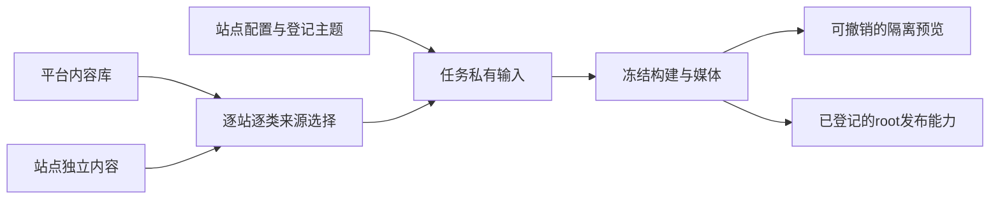

[English](./CONTENT_WORKSPACES.md) | **简体中文**

# 内容、站点与发布

平台内容库独立管理博客、相册、地点和友链，其存储 scope 不是网站记录。完整会话可读取平台库，平台管理员可编辑。两个作用域共用既有内容库的验证、原子文件替换和摘要 ETag。

每个受管网站分别为四类内容选择平台源或独立源。站点成员读取解析后的数据；共享内容在站点中只读并链接至平台编辑，站点编辑者不能经站点或媒体后台任务获得平台写权限。切源只修改带独立修订 ETag 的绑定，切回后原有独立内容及站点配置仍保留。

博客工作区直接管理文章、分类、标签和媒体；文章已有词条自动展示，原有引用保留以兼容主题。博客图片存入数据库，支持 JPEG、PNG、WebP 和 GIF。服务启动时在后台接入平台已有图片，其他来源在打开媒体列表或构建时接入，原文件保留。上传文件或文件夹时，同路径的不同图片不会被覆盖。构建时图片按原 URL 写入冻结快照，来源路径冲突会阻止构建；数据库备份须包含图片数据。单张上传上限为 40 MiB，单个发布的冻结媒体总量上限为 512 MiB。

文章日期时间保存为 UTC，纯日期保留日期值；管理台的展示时区及日期格式在浏览器设置中选择。

来源类型和工作区能力分别表达。重定向、反向代理和受保护管理入口保留 Caddy 配置管理；有目录且完成登记的静态网站可在保留现有内容的情况下接管，随后选择登记主题、配置主题和站点资料、构建及预览。菜单和 API 守卫使用同一能力模型。总览根据所选内容计算实际数量，未配置流量统计时不填造数据。

构建入队时冻结来源映射，执行时把所选内容和站点配置复制到任务私有目录；主题准备及相册索引不经构建写回平台库。图片、旧文章资源和相册媒体随产物一起冻结。预览只读取冻结文件并拒绝 Service Worker 注册；关闭后撤销租约并移除外层页面中的 frame，旧链接不能启动新实例。

仅 root 使用的 `fuyao-caddy-register` 验证完整 Caddy 配置，可登记支持的内联块及直接 import，不向应用授予该命令的 sudo 权限。真正发布还需运维策略绑定站点 ID、允许的主题 ID 和固定路径槽位。helper 将发布产物和媒体密封到 root 拥有的目录，保留无关路由、共享 snippet 和代理规则。激活桥协调数据库与实际 Caddy 运行配置，提交失败或不确定时补偿或停止后续修改。配置回退只回滚设置并保留当前网站版本；网站版本回退通过发布流程执行。

简单静态块在冻结主题包含 `200.html` 时启用仅发布生效的网页回退，缺失静态文件和 API 不参与回退。复杂规则须经运维显式审阅并使用 `--preserve-routing`；受 `handle_path` 约束的目录不能被当成已支持完整主题的网站。网站转换、预览与已登记的真正发布能力分别判断。

可选 Cloudflare 统计复用绑定到单站点的固定 loopback 只读来源。总览显示最新单日记录及日期，保留过期缓存状态；不把每日独立访客数相加冒称周期去重人数，也不把不可用来源显示成零。

## 导入现有网站

`fuyao-admin import-content` 是运维命令，接受 `--source-config`、`--source-content` 和 `--source-favicon`；`--platform-root` 导入独立平台库，配合 `--sites-root`、`--site-id` 还可建立站点配置和内容独立副本。必须在新服务首次启动前导入，已有目标 scope，包括已初始化的空库，均不会被覆盖。root 执行时可用 `--owner` 把导入目录交给服务账号。

只复制 site.yaml、content.yaml、favicon，以及 posts/data/albums/images/wp-content，不带运行状态或秘密环境文件。拒绝链接、重叠根及迁移期间变化的源清单，保留原目录。站点配置保留未建模的 YAML 字段。数据导入本身不选择主题、不切换 Caddy 根目录，也不发布构建。

程序版本、平台数据、站点业务发布和 root 密封服务树分别维护生命周期。迁移期间留存数据库、配置备份及上一份服务配置。既有 public-data 和 legacy 服务可独立运行，网站发布后通过平台的新权威数据进行编辑。
